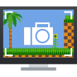

#  Screenies - The SonicDE Screenshot Utility

Screenies is a screenshot and screen-recording utility for the SonicDE desktop.
It can also be used in other X11 desktop environments.

## Get help

Report problems and ask questions in the
[Screenies issue tracker](https://github.com/Sonic-DE/sonic-screenies/issues).

## Contributing

Screenies is developed as part of SonicDE.

Please see the file [`CONTRIBUTING`](./CONTRIBUTING.md) for details on coding style and how
to contribute patches. Submit changes as a
[pull request on GitHub](https://github.com/Sonic-DE/sonic-screenies/pulls).

## Releases

See [Screenies releases](https://github.com/Sonic-DE/sonic-screenies/releases)
for release information.

## Reporting Bugs

Please report bugs in the
[Screenies issue tracker](https://github.com/Sonic-DE/sonic-screenies/issues).
